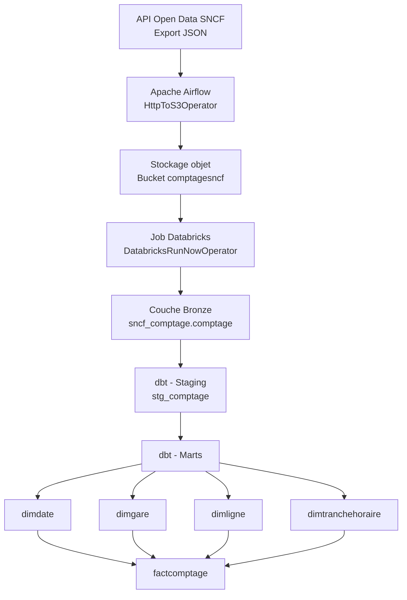
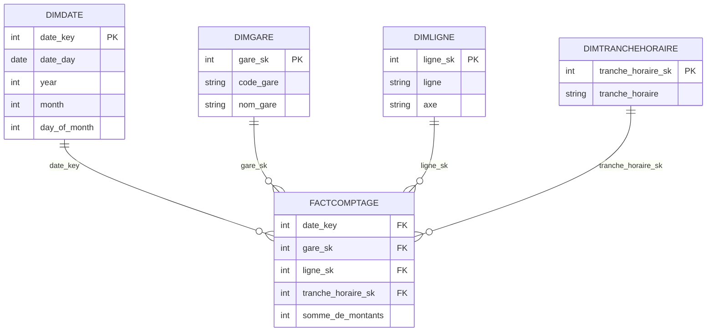

# Pipeline de comptage voyageurs SNCF

Pipeline de données orchestré avec **Apache Airflow**, intégrant les données ouvertes de comptage des voyageurs des trains Transilien, puis les transformant avec **dbt** sur **Databricks** pour construire un modèle analytique en étoile.

> Cette documentation décrit l'implémentation présente dans le dossier `comptage_sncf_airflow`. Les paramètres d'accès aux services (connexions Airflow, profil dbt, identifiants Databricks et stockage objet) doivent être configurés dans l'environnement d'exécution ; aucun secret n'est documenté ici.

## 1. Objectif

Le projet automatise une chaîne de traitement quotidienne autour du jeu de données SNCF `comptage-voyageurs-trains-transilien`.

Le workflow défini dans le DAG `comptage_dag` enchaîne quatre étapes :

1. Récupérer l'export JSON du jeu de données depuis l'API Open Data.
2. Déposer le fichier dans un bucket compatible S3.
3. Déclencher un job Databricks chargé de l'ingestion dans le Lakehouse.
4. Exécuter les transformations dbt, puis les tests, sur les couches staging et mart.

La finalité analytique est de structurer les comptages dans un modèle dimensionnel afin de faciliter les analyses par date, gare, ligne et tranche horaire.

## 2. Architecture



### Composants

| Composant | Rôle dans le projet |
|---|---|
| API Open Data SNCF | Fournit l'export JSON du jeu de données de comptage Transilien. |
| Apache Airflow | Planifie et orchestre les différentes étapes du pipeline. |
| Stockage compatible S3 | Reçoit les exports JSON datés. Le DAG cible le bucket `comptagesncf`. |
| Databricks | Exécute le job d'ingestion qui alimente la table source utilisée par dbt. |
| dbt Core / dbt-databricks | Nettoie les données, construit les dimensions et la table de faits, et exécute les tests. |
| PostgreSQL | Stocke la métadonnée Airflow dans la configuration Docker Compose. |
| Redis et CeleryExecutor | Fournissent le broker et l'exécution distribuée des tâches Airflow dans l'environnement local. |

**Périmètre documenté :** le code fourni contient le DAG Airflow et les modèles dbt. Le code interne du job Databricks d'ingestion ainsi que la configuration de la connexion au stockage ne figurent pas dans ce dossier ; leur fonctionnement détaillé ne peut donc pas être décrit ici.

## 3. Orchestration Airflow

Le DAG est défini dans `dags/comptage_dag.py`.

| Propriété | Valeur |
|---|---|
| Identifiant | `comptage_dag` |
| Planification | `@daily` |
| Date de début | `2023-01-01` |
| Catchup | Désactivé (`False`) |
| Nombre de retries | 1 |
| Délai avant retry | 3 minutes |
| Notification d'échec | Activée par e-mail dans les paramètres par défaut |

### Déroulement des tâches

#### 3.1 `download_data`

Utilise `HttpToS3Operator` pour appeler l'export JSON du jeu de données SNCF :

```text
/api/explore/v2.1/catalog/datasets/comptage-voyageurs-trains-transilien/exports/json
```

Le fichier est déposé dans le bucket `comptagesncf` sous une clé datée :

```text
data_{{ ds }}.json
```

L'option `replace=True` autorise le remplacement d'un objet portant la même clé. La tâche utilise les connexions Airflow `sncf_comptage_endpoint` pour l'API et `cloudfare_conn` pour l'accès S3.

#### 3.2 `run_ingestion`

Utilise `DatabricksRunNowOperator` pour lancer un job Databricks existant, via la connexion Airflow `databricks_default`.

Le DAG fourni contient `job_id=12345` : cette valeur doit être remplacée par l'identifiant réel du job dans l'environnement cible.

#### 3.3 `run_dbt`

Lance les commandes dbt prévues pour la phase staging :

```bash
dbt run --staging
dbt test --staging
```

#### 3.4 `run_dbt_mart`

Lance les commandes dbt prévues pour la construction des marts :

```bash
dbt run --mart
dbt test --mart
```

Les dépendances sont séquentielles :

```text
download_data >> run_ingestion >> run_dbt >> run_dbt_mart
```

**Point de configuration à vérifier avant exécution :** les commandes `--staging` et `--mart` doivent correspondre à des options ou sélecteurs effectivement configurés dans l'environnement dbt. Le projet fourni ne contient pas de fichier `selectors.yml`. Il faudra donc valider ces commandes ou les remplacer par des sélections dbt explicites, par exemple `--select staging` et `--select mart` si les chemins/noms de modèles correspondent à la sélection voulue.

## 4. Transformations dbt

Le projet dbt se trouve dans `dbt_project/`. Le fichier `dbt_project.yml` définit deux groupes de modèles :

- `staging` : matérialisation en tables dans le schéma `silver` ;
- `mart` : matérialisation en tables dans le schéma `gold`.

La macro `generate_schema_name` personnalise le nom du schéma généré : lorsqu'un schéma personnalisé est défini sur un modèle, la macro renvoie ce nom au lieu de le préfixer par le schéma cible.

### 4.1 Source Bronze

La source est déclarée dans `models/source/source.yml` :

- source dbt : `bronze` ;
- table : `comptage` ;
- base/catalogue déclaré : `sncf_comptage`.

La définition décrit notamment les colonnes `id`, `somme_de_montants` et `code_gare`. Des tests de source sont déclarés : unicité et non-nullité de `id`, non-nullité de `somme_de_montants` et `code_gare`.

### 4.2 Staging : `stg_comptage`

Le modèle `models/staging/stg_comptage.sql` prépare les données issues de la source Bronze :

- suppression des doublons avec `SELECT DISTINCT` ;
- conversion de `annee` et `somme_de_montants` en entiers ;
- nettoyage des champs textuels avec `TRIM` ;
- conversion de `date` au type `DATE`.

Le modèle conserve les attributs suivants : `annee`, `axe`, `code_gare`, `date`, `ligne`, `nom_gare`, `somme_de_montants`, `tranche_horaire` et `type_jour`.

### 4.3 Dimensions

| Modèle | Contenu | Clé générée |
|---|---|---|
| `dimdate` | Calendrier quotidien du 01/01/2000 au 31/12/2030, avec attributs d'année, trimestre, mois, semaine, jour et indicateurs de week-end. | `date_key` au format `yyyyMMdd` |
| `dimgare` | Liste distincte des couples code gare / nom gare issus du staging. | `gare_sk` |
| `dimligne` | Liste distincte des couples axe / ligne. | `ligne_sk` |
| `dimtranchehoraire` | Liste distincte des tranches horaires. | `tranche_horaire_sk` |

Les clés des dimensions gare, ligne et tranche horaire sont générées avec `ROW_NUMBER()` selon un ordre déterminé par les colonnes indiquées dans chaque modèle.

### 4.4 Table de faits : `factcomptage`

La table `factcomptage` relie le staging aux quatre dimensions à l'aide de jointures :

- date : `date` vers `dimdate.date_day` ;
- gare : `code_gare` vers `dimgare.code_gare` ;
- ligne : `ligne` vers `dimligne.ligne` ;
- tranche horaire : `tranche_horaire` vers `dimtranchehoraire.tranche_horaire`.

Elle expose les clés des dimensions et la mesure `somme_de_montants`.

La granularité exacte dépend des données sources et des combinaisons présentes dans `stg_comptage`. Le modèle SQL ne réalise pas d'agrégation supplémentaire : il projette les lignes du staging après jointure aux dimensions.

> Le champ `type_jour` est conservé dans le staging mais n'est pas utilisé dans les dimensions ou la table de faits actuelles. Aucune dimension `type_jour` n'est définie dans le modèle fourni.

## 5. Modèle analytique

Le modèle cible est un schéma en étoile composé de la table de faits `factcomptage` et de quatre dimensions :



Ce modèle permet de structurer les analyses autour du temps, des gares, des lignes et des tranches horaires.

## 6. Environnement local

Le fichier `docker-compose.yaml` définit un environnement Airflow local comprenant :

- un webserver Airflow exposé sur le port `8080` ;
- un scheduler ;
- un worker Celery ;
- un triggerer ;
- un service d'initialisation ;
- PostgreSQL 13 pour la métadonnée Airflow ;
- Redis 7.2 comme broker Celery.

Le `Dockerfile` part de l'image `apache/airflow:2.10.3` et installe les dépendances listées dans `requirements.txt`, notamment les providers Amazon et Databricks ainsi que dbt Core et dbt-databricks.

### Démarrage

Depuis le répertoire `comptage_sncf_airflow` :

```bash
docker compose build
docker compose up airflow-init
docker compose up -d
```

L'interface Airflow est ensuite accessible à l'adresse :

```text
http://localhost:8080
```

Dans la configuration Compose fournie, les identifiants initiaux par défaut sont `airflow` / `airflow`, sauf surcharge par variables d'environnement. Il est recommandé de les modifier avant toute exposition du service.

Pour arrêter les services :

```bash
docker compose down
```

Pour arrêter les services et supprimer également le volume de métadonnées PostgreSQL :

```bash
docker compose down -v
```

Cette dernière commande supprime les données persistées dans ce volume.

## 7. Configuration nécessaire

Avant de lancer le DAG, configurer les éléments suivants dans Airflow et dbt.

### Connexions Airflow

| Connexion | Utilisation |
|---|---|
| `sncf_comptage_endpoint` | Endpoint HTTP de l'API Open Data SNCF. |
| `cloudfare_conn` | Accès au stockage objet compatible S3. |
| `databricks_default` | Accès au workspace Databricks. |

Le bucket `comptagesncf` doit exister et être accessible par la connexion de stockage.

### Job Databricks

- Créer ou identifier le job d'ingestion.
- Remplacer `12345` dans `comptage_dag.py` par son identifiant réel.
- Vérifier que le job lit les fichiers déposés dans le bucket et alimente la source déclarée pour dbt (`sncf_comptage.comptage`).

Le code du job d'ingestion n'étant pas présent dans ce dossier, ses paramètres et son implémentation doivent être documentés séparément.

### Profil dbt

Le projet déclare le profil `dbt_project` dans `dbt_project.yml`. Un profil dbt correspondant doit être fourni dans l'environnement Airflow, avec un adaptateur Databricks et les paramètres de connexion au workspace/catalogue/schema appropriés.

Le fichier `profiles.yml` n'est pas inclus dans le dossier fourni. Il doit être créé/configuré séparément et ne doit pas contenir de secrets versionnés dans Git.

### Chemins et commandes dbt dans le DAG

Le `docker-compose.yaml` monte le projet dbt dans `/opt/airflow/dbt_project`, tandis que les commandes du DAG utilisent le chemin `/opt/airflow/dags/comptage_sncf_airflow`.

Ces chemins ne correspondent pas à la configuration de volumes visible dans le Compose fourni. Avant exécution, harmoniser le `cd` des tâches dbt avec le chemin réel du projet monté, ou modifier les volumes Compose en conséquence.

## 8. Arborescence du dossier

```text
comptage_sncf_airflow/
├── dags/
│   └── comptage_dag.py
├── dbt_project/
│   ├── analyses/
│   ├── macros/
│   │   └── generate_schema.sql
│   ├── models/
│   │   ├── source/
│   │   │   └── source.yml
│   │   ├── staging/
│   │   │   └── stg_comptage.sql
│   │   └── mart/
│   │       ├── dimdate.sql
│   │       ├── dimgare.sql
│   │       ├── dimligne.sql
│   │       ├── dimtranchehoraire.sql
│   │       └── factcomptage.sql
│   └── dbt_project.yml
├── Dockerfile
├── docker-compose.yaml
└── requirements.txt
```

## 9. Améliorations envisageables

Les éléments suivants sont des pistes d'évolution et ne sont pas présentés comme des fonctionnalités déjà implémentées :

- Ajouter des tests dbt sur les relations entre la table de faits et les dimensions, ainsi que des contrôles de valeurs métier.
- Documenter explicitement la granularité métier de `factcomptage`.
- Étudier la stabilité des clés substituts générées par `ROW_NUMBER()` lors des reconstructions des dimensions.
- Ajouter une dimension `type_jour` si cet attribut doit être exploité dans les analyses.
- Rendre les sélections dbt explicites avec des tags ou un fichier `selectors.yml`.
- Externaliser les paramètres d'environnement et renforcer la gestion des secrets.
- Ajouter des contrôles de fraîcheur et de volume des données, ainsi qu'une meilleure observabilité des exécutions.
- Ajouter des mécanismes de reprise et de déduplication adaptés aux fichiers d'entrée.

## 10. Technologies

- **Apache Airflow** : orchestration et planification.
- **Docker Compose** : environnement local multi-services.
- **PostgreSQL** : base de métadonnées Airflow.
- **Redis / Celery** : exécution des tâches Airflow.
- **Stockage compatible S3** : dépôt des exports JSON.
- **Databricks** : exécution du job d'ingestion et environnement analytique.
- **dbt Core / dbt-databricks** : transformations SQL, modélisation dimensionnelle et tests.
- **SQL / Spark SQL** : transformations des données.

---

**Dépôt GitHub :** https://github.com/boucingwithbud/comptage_voyageur_sncf

**Dossier documenté :** `comptage_sncf_airflow`
